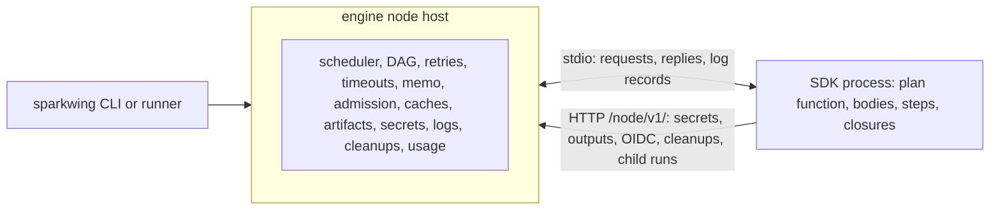

# Engine-hosted execution

Status: accepted design for contributors. [docs/node-protocol.md](../docs/node-protocol.md) is the wire contract; this page records how the engine uses it and why it is shaped this way.

Sparkwing runs every pipeline through one execution model. The engine hosts the run, and the customer's SDK process answers only for the parts that are customer code. The engine evaluates nothing written in the customer's language. It asks the SDK process for the plan, then schedules the plan, dispatches nodes, retries, times out, caches, stages artifacts, admits work, resolves secrets and handles logs. The SDK process builds plans, runs node and step bodies, and evaluates closures when the engine asks for them by id. Go and TypeScript pipelines run the same way.

## Why the engine hosts the run

When the orchestrator is a library compiled into the customer's pipeline binary, two things follow:

- Every engine behavior ships at whatever SDK version the customer pinned. A fix to retries or caching reaches a customer only after they rebuild.
- None of the engine is reusable from another language.

Moving the envelope into the engine fixes both. The SDK shrinks to what only it can do, and a new language needs only the five protocol operations and eight routes.

## The boundary

| Concern | The engine | The SDK process |
|---|---|---|
| Plan | asks for the plan with the run's args and run context, validates it, records the snapshot, and checks that each later process plans the same node | runs the author's plan function and returns the plan document |
| DAG | readiness, fan-out, dependency failure, optional dependencies, OnFailure recovery nodes, approvals | nothing |
| Retries and timeouts | attempts, backoff, wall and no-progress timeouts, killing the process session | nothing |
| Memo | the key from declared inputs, lookup and record | a `cache_key` closure returns a string when the author wrote one |
| Admission | per-node leases from declared resources, and measured per-node usage | may send `exec_end` records as an advisory breakdown |
| Artifacts | staging before the node starts, publishing after success | nothing |
| Dependency caches | restore before the node's first process, save after success, keyed from declared key files | declares the cache directories |
| Tools | puts the declared tools on `PATH` | declares the tool names |
| Secrets | resolves through the profile, registers values with the masker, answers the secrets route | asks the route by name |
| Logs | reads stdout and stderr, masks, timestamps, attributes records to node and step, stores | writes log records to stdout |
| Steps | orders steps, applies fail-fast, finally, continue-on-error, optional, step windows and dry-run | runs one step body when asked |
| Closures | decides when to call SkipIf, BeforeRun, Verify, AfterRun, cache-key and generator closures | evaluates a closure by id |
| Cleanup and git cache | owns the cleanup ledger and puts the git mirror rewrite into the environment | registers cleanups through a route |

## Process model

The engine starts the SDK entry with the single argument `--sw-node-protocol` for each of these:

- **describe**, for the CLI to list pipelines and parse flags;
- **plan**, once per run;
- **eval**, for closures the host evaluates outside an attempt, bound to one node;
- **attempt**, one process for each node attempt.

An attempt process answers `plan`, then `eval` and either `run_node` or a series of `run_step` requests for that node. Then the host closes stdin.

One process per attempt is the choice because:

- the process is the unit the host measures, so per-node CPU and memory are exact without the SDK's cooperation;
- a timeout or cancel kills one process session and nothing else;
- a retry starts clean, with no state left by the failed attempt;
- it matches the remote shape, where a node already runs in its own pod or launcher job.

The cost is that every process rebuilds the plan, because bodies and closures are captured while the plan function runs. That rebuild buys drift detection. The host compares the node's entry with the accepted snapshot and fails the attempt with `plan_drift` when they differ, so a node never runs code its plan did not hold.

One process per run was the alternative. It saves plan evaluations, but a crash or leak in one body takes every node down, usage is no longer per node, and it does not map onto pods.

`skip_if`, `cache_key` and `generator` closures run in an eval process before an attempt exists. A skipped or memoized node therefore never claims a pod or a runner slot. A remote run evaluates them on the host that runs the scheduler.

## Decisions

These choices go beyond the protocol's shape. Each needs Korey's ratification.

1. **Every attempt process answers `plan` before `run_node`.** `run_node` then needs no pipeline, args or run context, and drift becomes a host-side check rather than something each SDK must implement.
2. **The host computes `spec_hash`.** It hashes the canonical JSON of each node document with one function on both sides of the comparison. SDKs in different languages never have to produce byte-identical JSON.
3. **`--sw-node-protocol` is the only entry, and describe is a stdio request.** The `--describe` argument, `run-node`, `plan --json`, `handle-trigger`, `replay-node`, `ops`, `config`, `--plan` and `--explain` go away.
4. **The environment variables are renamed to `SPARKWING_NODE_URL` and `SPARKWING_NODE_TOKEN`.** The old `SPARKWING_CONTROLLER_URL` and `SPARKWING_AGENT_TOKEN` names said the SDK talks to a controller, which it no longer does. A stale binary that reads the old names finds nothing and fails loudly instead of calling `/api/v1/` paths on the node host.
5. **End of stdin replaces the liveness descriptor.** The mask-values descriptor goes too, because the host knows every secret it served.
6. **Outputs come back as JSON in the route response.** The host fetches and verifies the stored output, so an SDK never follows a signed URL.
7. **Awaiting a child run is a long poll that holds for at most 60 seconds.** The SDK repeats the call until the child finishes. While a call is open and the child waits in plan admission, the host pauses the parent node's timeout.
8. **One protocol version, matched exactly, with 426 on the routes.** The header costs little, and a later protocol bump needs it.
9. **`Inline` means "on the host that dispatches the run, in its own process".**
10. **The host's measured usage is the authority for per-node numbers**, and `exec_end` is advisory.
11. **Registered cleanups run when the attempt process exits, unless released.** They also run on a clean exit, because a library that did not release its cleanup did not clean up.

## Cutover

This is a hard cut in one breaking release:

- the in-process path is deleted;
- the CLI, runners, the launcher and Kubernetes jobs reach a pipeline only through `--sw-node-protocol`;
- a pipeline binary built against an older SDK does not answer it, and the engine reports that the entry must be rebuilt;
- there are no migrations for old pipeline modules, binaries or stores, and no minimum-SDK gate;
- the changelog carries one Breaking entry: rebuild `.sparkwing` against the new SDK.

This repository's own CI builds `.sparkwing` against the SDK in the same commit, so from the cutover onward it needs a CLI built from that commit too.

## Changes by component

| Component | Engine-hosted | Replaces |
|---|---|---|
| CLI `run` | builds the SDK entry and runs the host, either in-process or through the admission daemon. Step windows, dry-run, `only` and `no-cache` are host state | executing the binary with run options as `SPARKWING_*` variables |
| CLI help, `plan`, `explain` | renders describe and the plan document | asking the binary for its own help and plan text |
| Local runner | starts `<entry> --sw-node-protocol`, sends requests and reads results from stdout | `run-node --coordinated` and re-reading the node row |
| Runner and trigger loop | schedules the run from the plan document and dispatches nodes through the Kubernetes and launcher runners | executing `handle-trigger` and letting the binary dispatch |
| Pod side | `sparkwing-runner run-node` holds the claim, serves the node routes, starts the entry, and reports the attempt | executing the binary's `run-node` with the claim fence in its environment |
| Admission daemon | leases taken by the host per node | leases taken by the binary's dispatcher |
| Node routes | `/node/v1/` on the node host, with a bearer per node process | the `/api/v1/` node routes, the execution broker, and the loopback controller's node-facing routes |

## Failure modes

| Failure | Host behavior |
|---|---|
| The SDK process exits without answering | the attempt fails with `sdk_exited` and the exit status or signal; the retry policy applies; records already read are kept |
| The SDK process hangs | the wall or no-progress timeout kills the session; no-progress counts log silence |
| A reply to an id the host never sent, a second reply, or a malformed reply | the attempt fails with `protocol_error`; the host never guesses which answer counts |
| A stdout line that is not JSON | stored as a text record, never parsed as a reply |
| A process plans a different node | the attempt fails with `plan_drift` |
| A plan with a cycle, an unknown dependency or duplicate ids | the run fails with `plan_invalid` before any node starts |
| A protocol version other than the host's | the CLI refuses the entry at describe; a plan with another version fails the run with `protocol_mismatch` |
| An unknown op, node, step or closure | the attempt fails with the SDK's code, and the reason names the SDK and its version |
| The host restarts mid-node | the process sees end of stdin and exits; the run's recovery marks the attempt lost and the retry policy decides |
| A route call fails | the SDK raises inside the body, so the node fails with that error |

## What the spike proved

An internal spike, reachable only from tests, ran a two-node plan with the engine owning the run row, the node rows and the DAG order:

- Each node ran in its own process. The dependent started only after its dependency succeeded, and a failed dependency skipped its dependent without starting it.
- A node read its dependency's typed output through the engine, and its log records reached the host through stdout unchanged.
- Plan evaluation coupled to a controller does not fit the model. The spike's `plan --json` read the run row through a controller, and its `run-node` re-read the run row and wrote its own terminal row. That is why `plan` takes its run context in the request and `run_node` answers with a result.

## Open questions

- **TypeScript discovery.** How the CLI recognizes a TypeScript entry, and whether the runner image ships Node. The proposal is a `.sparkwing/package.json` that depends on `@sparkwing/sdk`, and Node LTS in the runner image.
- **Cleanup time limit.** How long the host lets one cleanup command run before it kills it. Customers would notice this limit, so the value needs Korey's approval and a comparison with GitHub Actions and CircleCI.
- **Node output size.** A node's output travels inside one reply line, and a line is at most 16 MiB, while the store accepts outputs up to 64 MiB. Either the smaller limit is accepted, which customers would notice and so needs Korey's approval, or a larger output takes another path, such as a file the SDK names in its result.
