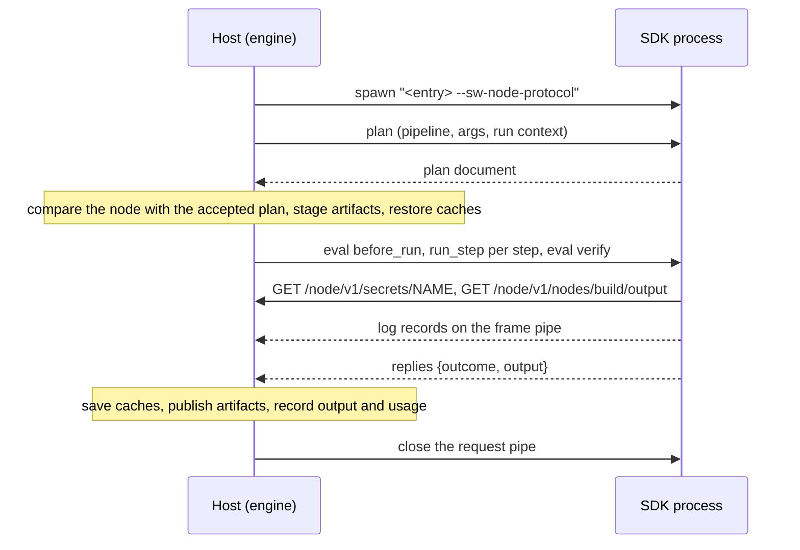

# Node protocol

The node protocol is the contract between the engine, which hosts a run, and an SDK process, which holds a pipeline's code. Any language can implement the SDK side. The Go SDK in `sparkwing/` is one implementation and the TypeScript SDK in `sdk/typescript` is another. `design/engine-hosted-execution.md` in the source repository explains why the engine is split this way.

Status: `sparkwing run` hosts its run this way, and a launcher Job hosts its node this way. A trigger runner's runs, the Kubernetes Jobs it dispatches, a detached run and the child runs a local node starts still run in the pipeline binary's own dispatcher. The TypeScript SDK is a prototype that no command starts.

The conformance suite in `internal/nodeproto/conformance` in the source repository checks an SDK against this page. `testdata/fixture.json` there describes a fixture pipeline that each SDK implements and the replies the suite expects from it.

## Overview

- **The host runs everything that is not customer code.** It handles DAG order, retries, timeouts, memo, dependency caches, artifacts, admission, approvals, secrets, masking, logs, process cleanup and usage measurement.
- **The SDK process runs customer code only:** the plan function, node and step bodies, and closures such as `SkipIf` and `Verify`. It runs each one only when the host asks.
- **One entry point:** `<entry> --sw-node-protocol`. The host writes requests on a dedicated request pipe, and the SDK writes replies and log records on a dedicated frame pipe, one JSON object per line. stdout and stderr carry only the customer's text, which the host never parses. There are six operations: `describe`, `plan`, `run_node`, `run_step`, `cancel` and `eval`.
- **One process per node attempt.** Each node process answers `plan` first. If the node's entry differs from the plan the run accepted, the host fails the node with `plan_drift`.
- **Closures by id.** The plan lists every closure under an id. The host decides when each one runs and sends `eval`. A generator closure returns the nodes of a dynamic fan-out.
- **Eight HTTP routes under `/node/v1/`** on a loopback URL, with a bearer scoped to one node process. They cover secrets, other nodes' outputs, OIDC tokens, cleanups, child runs and their results, and the latest run of another pipeline.
- **Seven environment variables** name the run, the node, the routes and the runner. A process that is not bound to a node gets none of them. On Windows one more names the protocol pipes.
- **One protocol version, `1`, matched exactly.** A route request with another version gets HTTP 426. A describe or plan document with another version is refused before any node starts.
- **Hard cut.** A pipeline binary built before this protocol does not run on an engine that speaks it. Rebuilding `.sparkwing` against a matching SDK is the only migration.



## Processes

The host starts the SDK process from the repository root, the directory that holds `.sparkwing/`, with `--sw-node-protocol` as the last argument of the entry's command:

- **Go.** A `.sparkwing/` Go module is compiled, and the entry is the binary, so the command is `<binary> --sw-node-protocol`.
- **TypeScript.** A `.sparkwing/package.json` that depends on `@sparkwing/sdk` is a TypeScript pipeline. Its `main` field names the entry file. The command is `node --import <bootstrap> <main> --sw-node-protocol`, where `<bootstrap>` is the file URL of the installed SDK's `./bootstrap` export. Node.js evaluates that preload before any module of the entry, so it removes `SPARKWING_NODE_TOKEN` and `SPARKWING_PROTOCOL_HANDLES` before entry code or a module the entry imports can copy them. The SDK refuses to serve a process that was not started with that preload, and keeps what the preload captured in a module the package does not export. The host runs `npm ci` in `.sparkwing/` first when `node_modules` lacks the SDK, and needs Node.js 22.18 or later on `PATH`. A runner, whether a launcher Job, a dispatched Job or a warm runner, runs it with the environment its node processes get, the minimal set plus the dependency proxy and the runner's proxy and CA settings, so install hooks never see the runner's credentials.

The preload keeps the bearer from the tools a step starts, not from the repository's own code. Pipeline code, which includes the `node_modules` its lockfile installs, is trusted with its node's bearer and drives the node routes with it; it can also choose the installed SDK and `NODE_OPTIONS`. What it must never receive is the runner's own credentials.

A process either is bound to one node or is not bound to any:

| Process | Bound to | Requests it receives | Environment |
|---|---|---|---|
| describe | nothing | `describe` | no contract variables |
| plan | nothing | `plan` | no contract variables |
| eval | one node, outside any attempt | `plan`, then `eval` for that node's `skip_if`, `cache_key` and `generator` closures | node variables |
| attempt | one node, one attempt | `plan`, then `eval`, `run_node` or `run_step` for that node | node variables |

The SDK does not need to know which kind of process it is. It answers whatever arrives under these rules:

1. `describe` may be the first request and needs no plan.
2. Every other request except `plan` needs a `plan` earlier in the same process; without one the SDK replies `no_plan`.
3. `plan` arrives at most once per process.
4. `run_node`, `run_step` and `eval` name a node, step or closure from that plan, or from a generator evaluated earlier in the same process.

For one node attempt the host sends requests in this order:

1. `plan`, with the pipeline, args and run context the run accepted. The host hashes the node's entry in the reply and compares it with the accepted plan's `spec_hash`. On a mismatch, or if a node of the accepted plan is missing, the attempt fails with `plan_drift`.
2. For a node a generator added, `eval` of the generators that led to it in place of that comparison, which rebuilds the node in this process. The host compares the rebuilt node with the `spec_hash` it recorded when it added the node.
3. On attempt 1 only, `eval` for each `before_run` closure in order.
4. One `run_node` for a node without steps, or one `run_step` per step for a node with steps (see [Steps](#steps)).
5. After a successful body, `eval` of the `verify` closure.
6. After a successful body and `verify`, `eval` for each `generator` closure in order (see [Dynamic nodes](#dynamic-nodes)).
7. On the last attempt, whether it succeeded or ran out of retries, `eval` for each `after_run` closure.
8. Close the request pipe.

The host evaluates `skip_if` and `cache_key` closures before the first attempt starts, so a skipped or memoized node never gets an attempt. It evaluates a `generator` in its source node's attempt process, or in an eval process when memo copied the source's result. It may use a separate eval process on the run's host for `skip_if` and `cache_key`, or an attempt process, and the SDK answers the same way in both.

## Framing

- **Streams.** The SDK reads requests from the request pipe and writes replies and log records to the frame pipe. On Unix these are descriptors 3 and 4. On Windows they are inherited pipe handles, and `SPARKWING_PROTOCOL_HANDLES` holds their values as `<request>,<frame>` in decimal. stdin is the null device (`/dev/null`, or `NUL` on Windows).
- **Close-on-exec.** At startup the SDK marks both protocol descriptors close-on-exec, or makes both handles non-inheritable, and removes `SPARKWING_PROTOCOL_HANDLES` from its environment. A command the SDK starts therefore never holds them.
  - The Go SDK does this, and removes `SPARKWING_NODE_TOKEN` from its environment, while packages initialize, before the `init` of any package that imports the SDK. A package that does not import the SDK is not ordered after it, so its `init` can read the bearer, and a command its `init` starts can inherit both pipes and the bearer. Pipeline code should not read the environment or start commands during package initialization.
- **User text.** stdout and stderr belong to customer code and the commands it starts. The host stores each stdout line verbatim as an `info` text record and each stderr line as a `warn` text record, and never parses either stream. Nothing a customer prints can forge a reply or a record.
- **Requests.** The host writes one JSON object per line to the request pipe, in the form `{"id": "<id>", "op": "<op>", ...fields}`. The host assigns ids as decimal strings counting from `"1"`, unique within the process.
- **Lines.** Every line on the frame pipe is at most 17 MiB, newline included. The host strips a trailing `\r`.
- **Replies.** A frame that is a JSON object with a `reply` key is a reply, and it must be well formed. A successful reply is `{"reply": "<id>", "ok": true, "result": {...}}` and carries no `error`. A failed reply is `{"reply": "<id>", "ok": false, "error": {"code": "<code>", "message": "..."}}` and carries no `result`. `ok` is a JSON boolean, `error.message` is required and `error.code` is optional.
- **Log records.** Every other frame is a log record: a JSON object with a string `ts` and correctly typed known fields (see [Log records](#log-records)). The host ignores keys it does not know.
- **Protocol errors.** The host fails the attempt with `protocol_error` for a frame that is neither a well-formed reply nor a log record, a frame over 17 MiB, a reply to an id the host never sent, or a second reply to the same id.
- **Concurrency.** The host may have several `eval` and `run_step` requests in flight in one process, and the SDK may answer them in any order. A `cancel` may be sent at any time. At most one `run_node` is in flight. `run_node` and `run_step` are never in flight together, and `describe` and `plan` are always sent alone.
- **End of input.** End of file on the request pipe means the host is done with the process. The SDK cancels any request still running, writes nothing further, and exits with status 0. The host closes the pipe only after every reply arrives, so a close mid-request means the host stopped the attempt or is itself gone.
- **Early end of output.** If the SDK exits, or closes the frame pipe, with a request still unanswered, the attempt fails with `sdk_exited` or `frames_closed`.
- **Stopping.** For a timeout or a cancel, the host sends SIGTERM to the process session and SIGKILL after its termination grace.

## Requests

| `op` | Fields | `result` |
|---|---|---|
| `describe` | none | the describe document: `{protocol, sdk?, pipelines}` |
| `plan` | `pipeline`, `args`, `run` | the plan document |
| `run_node` | `node`, `attempt`, `failure?` | `{outcome, error?, output?}` |
| `run_step` | `node`, `step`, `attempt`, `failure?` | `{outcome, error?, output?}` |
| `cancel` | `node`, `step` | `{}` |
| `eval` | `closure`, `input?` | `{value?, error?}` |

[schemas/node-protocol.schema.json](schemas/node-protocol.schema.json) is the JSON Schema for requests, replies and results: `$defs/request`, `$defs/reply`, `$defs/runResult` and `$defs/evalResult`. [schemas/describe.schema.json](schemas/describe.schema.json) covers the describe and plan documents. In the transcripts below, `->` lines travel on the request pipe and `<-` lines on the frame pipe.

### describe

`describe` needs no run and no environment. The CLI uses it to list pipelines, parse flags and render help. `sdk` names the SDK so a refusal can say what to upgrade.

```text
-> {"id":"1","op":"describe"}
<- {"reply":"1","ok":true,"result":{"protocol":"1","sdk":{"language":"go","version":"v0.68.0"},"pipelines":[{"name":"ship","short":"Build and deploy","args":[{"name":"env","go_name":"Env","type":"string","required":true}]}]}}
```

### plan

`plan` runs the pipeline's plan function and returns the plan document.

- `pipeline` is a name from describe.
- `args` maps each flag name to its string value.
- `run` is the run context, which plan code reads from its run context object.

The run context has these fields, and only `run_id` is required. The pipeline is the request's own `pipeline`.

- `run_id`;
- `started_at`, an RFC 3339 time;
- `trigger`: `{source, user?, pull_request?}`. `source` is `manual`, `push`, `schedule` or `webhook`. `pull_request` is `{number, action, base_ref, base_sha, head_ref, head_sha}`;
- `git`: `{sha, branch, default_branch?, repo?, repo_url?}`;
- `dry_run` and `no_cache`, both booleans.

Plan code must be deterministic for a given request, because every eval and attempt process plans again and the host compares the result.

A plan function that returns an error or throws gives the error code `plan_failed`. Args that fail the pipeline's declared types give `invalid_args`. An unregistered pipeline gives `unknown_pipeline`.

```text
-> {"id":"1","op":"plan","pipeline":"ship","args":{"env":"prod"},"run":{"run_id":"run-1","trigger":{"source":"push"},"git":{"sha":"4f2c1e0","branch":"main","repo":"acme/app"},"dry_run":false}}
<- {"reply":"1","ok":true,"result":{"protocol":"1","pipeline":"ship","run_id":"run-1","nodes":[{"id":"build","deps":[],"work":{"steps":[{"id":"compile"},{"id":"test","needs":["compile"],"is_result":true}],"result_step":"test"}},{"id":"deploy","deps":["build"],"modifiers":{"timeout_ms":600000},"closures":{"skip_if":["deploy/skip_if/0"],"verify":"deploy/verify/0","after_run":["deploy/after_run/0"]},"work":{"steps":[{"id":"apply","is_result":true}],"result_step":"apply"}}]}}
```

### run_node and run_step

- `run_node` runs the body of a node that lists no steps.
- `run_step` runs one step body of a node that lists steps.
- `attempt` counts from 1.
- `failure` appears only for a node whose plan entry has `on_failure_of`. It is `{node, stage, message}`, where `node` is the node that failed and `stage` is `action` or `verify`, so a recovery body can branch on how its parent failed.

The result has these fields:

- `outcome` is `success` or `failed`.
- `error` is the error message, a string, when the body returned an error or threw. It is a successful reply with `outcome: failed`, because the body ran. A failed reply means the node could not run at all.
- `output` is the body's JSON output. For `run_step` only the result step carries it, and the host records it as the node's output. An absent `output` means the node has none. A step's output, whether or not it travels, is at most 16 MiB as JSON; the SDK fails a step whose output is larger, and the host fails a node whose reply carries a larger one.

A step output stays in the SDK process's memory, so a later step in the same process can read it. The host never asks for it.

`cancel` cancels the context of that step's `run_step`, and the SDK answers it at once. The `run_step` still gets its own reply, usually `outcome: failed`. A `cancel` read before its `run_step` makes that step start cancelled, and one for a step that already ended does nothing.

```text
-> {"id":"2","op":"run_step","node":"deploy","step":"apply","attempt":1}
<- {"ts":"2026-01-02T03:04:05.123Z","level":"info","node":"deploy","step":"apply","msg":"applying release 42"}
<- {"reply":"2","ok":true,"result":{"outcome":"success","output":{"release":42}}}
-> {"id":"3","op":"eval","closure":"deploy/verify/0"}
<- {"reply":"3","ok":true,"result":{"value":null,"error":"health check: 503 from /ready"}}
-> {"id":"4","op":"eval","closure":"deploy/after_run/0","input":{"outcome":"failed","error":"verify: health check: 503 from /ready"}}
<- {"reply":"4","ok":true,"result":{"value":null}}
```

### eval

`eval` runs one closure by id. The result's `value` depends on the closure's kind (see [Closures](#closures)). `error` is the error message, a string, when the closure returned an error or threw. Like a body's error, it is a successful reply.

### Errors

A failed reply means the SDK could not do what the request asked, as distinct from customer code that ran and failed. The host fails the attempt and records the code as the node's failure reason. It also records the message and the SDK named by describe, so an author reads "this SDK does not support X" rather than a crash.

| `code` | Raised by | Meaning |
|---|---|---|
| `unknown_op` | SDK | The SDK does not implement this `op`. |
| `unknown_pipeline` | SDK | `plan` names a pipeline the SDK has not registered. |
| `unknown_node` | SDK | No node with this id is in the process's plan or its generated nodes. |
| `unknown_step` | SDK | The node has no step with this id. |
| `unknown_closure` | SDK | No closure with this id is in the process's plan or its generated nodes. |
| `no_plan` | SDK | The request needs a `plan` earlier in the same process. |
| `bad_request` | SDK | The request is malformed: a missing field, a second `plan`, or similar. |
| `invalid_args` | SDK | `plan` args fail the pipeline's declared flags. |
| `plan_failed` | SDK | The plan function returned an error or threw. |
| `plan_drift` | host | The node's entry in this process's plan differs from the accepted plan, or the node is missing from it. |
| `plan_invalid` | host | The plan document fails validation: an unknown dependency, a cycle, a duplicate node or closure id, or similar. The run fails before any node starts. |
| `protocol_mismatch` | host | The describe or plan document names a protocol version other than the host's. |
| `protocol_error` | host | The framing rules above were broken. |
| `sdk_exited` | host | The process exited with a request still unanswered. The reason includes the exit status or signal. |
| `frames_closed` | host | The process closed its frame pipe with a request still unanswered. |

The host treats a missing code, or one it does not know, as `sdk_error` and keeps the SDK's message.

## Closures

A closure is customer code that the host calls by id. The plan lists each node's closures under `closures`, and each step's under the step's own `closures`. The SDK assigns the ids. An id is opaque to the host, and it must be unique within the plan together with every generated node. The host refuses a plan with duplicate ids (`plan_invalid`). The Go SDK's ids look like `deploy/skip_if/0`; its encoding, described on `$defs/closures` in the schema, escapes `/` in node and step ids so they stay unique. Any SDK that builds ids from node and step ids must keep them unique when those ids contain `/`.

| Kind | Where the host evaluates it | `input` | `value` | When `error` is set |
|---|---|---|---|---|
| `skip_if` | eval process, before the first attempt. A step's runs in the attempt process, before that step | none | boolean; `true` skips the node or step. The host ORs several together | the host treats a node's as `false`; a step's fails that step |
| `cache_key` | eval process, before the first attempt | none | a string the host namespaces into the memo key, or `null` to run without memo. An empty string fails the node before it runs | the node fails before it runs |
| `before_run` | attempt process, attempt 1, before the body | none | `null` | the node fails without retrying |
| `verify` | attempt process, after each successful body | none | `null` | the attempt fails with reason `verify`, and retry and `on_failure` apply |
| `after_run` | the last attempt's process, after the body and verify | `{outcome, error?}`: the node's final outcome and error | `null` | the host logs it and leaves the node's outcome unchanged |
| `generator` | once per run: the source's attempt process, after its body succeeds, or an eval process on the run host when memo copied the source's result or the source ran on another host; again in each generated node's own processes, to load the node's code | none | an array of node documents | the generated group fails, and nodes that need it are cancelled |

The host bounds each node `skip_if` by the node's `modifiers.skip_if_budget_ms`, or by 30 seconds when that is absent. A `skip_if` that overruns its budget counts as `false`. A `cache_key` closure has its own 30-second limit, and one that overruns it fails the node. Every other closure is bounded by the node's wall timeout, except `after_run` after an attempt that timed out: the host evaluates it in an eval process of its own, bounded to 2 minutes.

A failed reply to `eval` (for example `unknown_closure`) is never read as `false` or as a skipped check. The attempt fails.

## Dynamic nodes

A generator closure adds nodes at run time. Its source node lists the closure under `closures.generator`. A node that waits for every generated node lists the closure id under `needs_generated`.

1. After the source's body succeeds, the host evaluates the generator in the source's attempt process, where the SDK still holds the source's output. It records the source's outcome and output before it adds any node. In a generated node's own processes the generator reads that output through `GET /node/v1/nodes/{node}/output`.
   - A memoized source whose result the host copied from an earlier run gets no attempt, and a source a runner-hosted run dispatched ran on another host. The run host evaluates their generators in an eval process instead, where `GET /node/v1/nodes/{node}/output` for the source itself answers the recorded output.
2. `value` is an array of node documents in the plan document's node shape. Each one lists the source in its `deps`, or is the `on_failure_of` node of one that does.
3. The host validates the new nodes against the plan (`plan_invalid`), records each one's row with its whole document, its source and generator, and schedules them. A node with `needs_generated` becomes ready once every generated node has finished. A recorded node's `pipeline_refs` are declared for its claims as a planned node's are; it reads only the secrets the pipeline declares.
4. The recorded documents are the run's generated nodes from then on: another host of a node runs the document its row holds, a resumed run keeps every recorded node, finished or not, and a retry copies its source run's. Each generator's batch stands alone: a complete one is kept as recorded, and only one the run never fully recorded is generated again, alone, keeping every node it did record; a batch that cannot be generated again, or whose regeneration drops or changes a recorded node, fails the run with `plan_drift`, cancels its waiters and ends each node it recorded as cancelled. A generated `on_failure` node's row lists its parent among its `deps`, so its processes may read the source's output.
5. Each generated node's eval and attempt processes evaluate the generators that led to it after `plan`, its source's first when the source was itself generated, to load the node's code, then run the node. The host compares the rebuilt node's `spec_hash` as in step 1 of the attempt order and fails it with `plan_drift` when they differ. A generator must therefore return the same nodes for the same source output.

```text
-> {"id":"2","op":"eval","closure":"targets/generator/0"}
<- {"reply":"2","ok":true,"result":{"value":[{"id":"test-linux","deps":["targets"]},{"id":"test-darwin","deps":["targets"]}]}}
```

## Steps

A node whose plan entry lists `work.steps` runs one `run_step` per step. The host schedules the steps itself:

- It orders them by `needs` and runs independent steps at the same time.
- It applies `work.failure_policy` (fail fast or collect all), `continue_on_error` and `optional`. Fail fast sends `cancel` for each running step other than a `finally` step, and records those steps as cancelled.
- It runs `finally` steps last.
- It evaluates step `skip_if` closures.
- It applies the run's step window (`start_at`, `stop_at`) and dry-run.
- It writes `step_start`, `step_end`, `step_skipped` and `work_fail_fast` records and the step rows.

In a dry run, the host runs a step only when the step has `has_dry_run` or `safe_without_dry_run`. It skips any other step with the reason `no_dry_run_defined`. The SDK runs a step's dry-run body instead of its body when the run context has `dry_run`.

## Describe and plan documents

[schemas/describe.schema.json](schemas/describe.schema.json) is the JSON Schema for both documents. The root is the `describe` result, `$defs/pipeline` is one pipeline, `$defs/plan` is the plan, and `$defs/node` is one node, which is also the shape a generator returns. The plan carries:

- nodes and their edges: `deps`, `optional_deps`, `needs_generated`, `on_failure_of`, `pipeline_refs`, and step `needs`;
- each node's envelope under `modifiers`:
  - retries and timeouts: `retry`, `retry_backoff_ms`, `retry_auto`, `timeout_ms`, `no_progress_timeout_ms`;
  - recovery: `on_failure`;
  - placement labels: `runs_on`, `prefers`, `when_runner`;
  - memo: `cache` and `cache_ttl_ms`;
  - the concurrency group: `conc_*`;
  - resources: `res_cores`, `res_memory_bytes`;
  - other flags: `inline`, `optional`, `continue_on_error`, `skip_if_budget_ms`;
- dependency caches under `caches`, which the host restores before the node's first process starts and saves after the node succeeds;
- memo key inputs under `memo_key`: files, environment names and constants that the host hashes, or a `cache_key` closure;
- closure ids under `closures`;
- tools the node needs on `PATH` under `tools`;
- artifacts: `outputs` (globs the node publishes after success) and `consumes` (producers whose artifacts the host stages first);
- approvals, which only the host runs, plus the node's declared secrets, the source checkout, and plan-level resources;
- plan-level concurrency groups under `plan_concurrency_groups`, each a scoped `key` with its `capacity`, `cost`, `on_limit`, `queue_timeout_ms` and `cancel_timeout_ms`, which the run holds from before its first node starts until it ends;
- steps under `work`, with `needs`, `finally`, `is_result`, `continue_on_error`, `optional`, `has_dry_run`, `safe_without_dry_run`, `closures`, and the node's `failure_policy`;
- `protocol`, the protocol version the SDK speaks.

`inline` means the host runs the node on the host that dispatches the run, in its own process, rather than through a runner. A node's `env` is added to the environment of that node's processes.

Two fields belong to the host and an SDK leaves them out:

- **`spec_hash`.** The host computes it over the node document in canonical JSON form (keys sorted, no insignificant whitespace, `spec_hash` itself excluded). It uses the same function on the accepted plan and on each later plan, so SDKs never have to agree on a JSON encoding.
- **`requires`.** The host fills it from `sparkwing.yaml`. The SDK never reads `sparkwing.yaml`.

## Environment contract

The host's caller names the base environment of every SDK process, and the host adds nothing from its own except the runner variables below:

- A local `sparkwing run` passes the user's environment.
- A launcher Job passes `PATH`, `HOME`, `TMPDIR`, `LANG`, `LC_*`, `TZ` and `USER` from the pod, plus `SystemRoot`, `ComSpec`, `PATHEXT`, `TEMP` and `TMP` on Windows.

From that base the host removes the `SPARKWING_*` variables the engine owns: credentials such as `SPARKWING_AGENT_TOKEN` and `SPARKWING_SECRETS_KEY`, run options such as `SPARKWING_START_AT`, and plumbing such as `SPARKWING_STATE_DB`. Every other `SPARKWING_*` variable the user set, such as a sparks setting or a cache URL, reaches the process. The host then sets the following. Values are strings.

| Variable | Set for | Meaning |
|---|---|---|
| `SPARKWING_RUN_ID` | eval and attempt processes | The run the node belongs to. |
| `SPARKWING_NODE_ID` | eval and attempt processes | The node the process is bound to. |
| `SPARKWING_NODE_URL` | eval and attempt processes | Base URL of the node routes, such as `http://127.0.0.1:41873`. A route's URL is this value followed by its `/node/v1/` path. |
| `SPARKWING_NODE_TOKEN` | eval and attempt processes | Bearer for the node routes. It is valid until the process exits. |
| `SPARKWING_RUNNER_NAME` | eval and attempt processes | The runner that hosts the node: `local` for a local run, the launcher's name in a launcher Job. |
| `SPARKWING_RUNNER_TYPE` | eval and attempt processes | `local` or `kubernetes`. |
| `SPARKWING_RUNNER_LABELS` | eval and attempt processes | The runner's labels, comma-separated: `local,os=<GOOS>,arch=<GOARCH>` for a local run; unset in a launcher Job, which advertises none. |
| `SPARKWING_PROTOCOL_HANDLES` | every process, Windows only | The request and frame pipe handles, as `<request>,<frame>` in decimal. |

The SDK removes `SPARKWING_NODE_TOKEN` from the environment of every command it starts, so a step's tools never hold the bearer. A command started during package initialization can still hold it; see [Framing](#framing).

- The TypeScript SDK removes it in the bootstrap preload, before any entry code runs.
- The Go SDK removes it while packages initialize, before the `init` of any package that imports the SDK. A package that does not import the SDK can initialize first and read it, as with the protocol pipes.

In a dry run the host adds `SPARKWING_DRY_RUN=1` to every process, the plan process included, so plan code and the commands a node starts see the same switch.

The host also sets variables that other tools already define, and the SDK needs to do nothing with them:

- the node's `env` from the plan;
- `PATH`, with the node's `tools` in front;
- the dependency-proxy variables `GOPROXY`, `npm_config_registry`, `PIP_INDEX_URL` and `PIP_TRUSTED_HOST`;
- the runner's proxy and CA settings `HTTP_PROXY`, `HTTPS_PROXY`, `NO_PROXY` (and their lowercase forms), `NODE_EXTRA_CA_CERTS` and `SSL_CERT_FILE`. A proxy URL's credentials are masked in the node's logs.

Run options are host state and never reach the SDK as variables. `start_at`, `stop_at`, `only`, `no_cache`, `profile`, `mode` and `workers` change what the host schedules. The two that plan code observes, `dry_run` and `no_cache`, travel in the `plan` request's run context.

## Node routes

A node-bound process calls these routes at `SPARKWING_NODE_URL`. The host serves them on loopback for the node it is running. On a remote runner, that is the runner process in the node's pod or job. Every request carries two headers:

- `Authorization: Bearer <SPARKWING_NODE_TOKEN>`
- `Sparkwing-Node-Protocol: 1`

The bearer names one run and one node, and expires when the process exits, so no route takes a run or a node of its own. In a path, `{node}` is a node id with `/` escaped as `%2F`, so `build/linux` is sent as `build%2Flinux`. Request and response bodies are JSON, and `?` marks an optional field.

An error response is `{"error": "<message>", "code": "<code>"}`. Every route can answer with these codes:

- 401 `unauthorized`: the bearer is missing, unknown or expired.
- 426 `protocol_mismatch`: the version header is missing or is not `1`. The body adds `"supported": ["1"]`.
- 400 `bad_request`: the body or the query is malformed.
- 429 `too_many_requests`: the node already has as many requests open as the route allows. See the limits below the table. The SDK may retry once one of its requests ends.
- 502 `upstream_unavailable`: the host could not reach the controller. The SDK may retry after a delay.

The host adds the controller credential and the claim fence when it forwards a request. The SDK never holds either.

<!-- node-routes:start -->
| Method | Path | Request | Response | Errors |
|---|---|---|---|---|
| GET | `/node/v1/secrets/{name}` | none | 200 `{value, masked}`. When `masked` is true, the host registers `value` with its masker before it answers | 404 `secret_not_found` |
| GET | `/node/v1/nodes/{node}/output` | none; `{node}` is a node of the bearer's run that the bearer's node depends on, directly or through other nodes, or the bearer's own node when memo copied its result | 200 `{output}`, the node's JSON output, `null` when it produced none | 404 `unknown_node`; 409 `not_ready` until the node finishes; 404 `no_output` when it finished neither successful nor cached; 403 `not_dependency` when the bearer's node does not depend on it |
| POST | `/node/v1/oidc-token` | `{audience}` | 200 `{token, expires_at}`; the host masks `token` | 404 `oidc_unavailable` when the controller holds no signing key |
| POST | `/node/v1/cleanups` | `{argv: [string], description?}` | 201 `{id}`. When the process exits, the host runs `argv` once, with no shell, unless the cleanup was released | none beyond the common ones |
| DELETE | `/node/v1/cleanups/{id}` | none; releases the cleanup | 204 | 404 `unknown_cleanup` |
| POST | `/node/v1/children` | `{pipeline, args?: {name: value}, repo?, branch?}`, at most 64 KiB | 201 `{run_id}`. The host records the node as the parent, links the new run to the run started by the node's previous attempt, and passes the trigger environment | 409 `cycle` when the pipeline is already among the run's ancestors; 422 `child_repo` when `repo` or `branch` names another repository or branch than the parent run's |
| GET | `/node/v1/children/{run}/await` | query `node?`, the node whose output to return, and `wait_ms?`, at most 60000 (default 30000) | 200 `{run_id, status, error?, output?}`. `status` is `pending`, `running`, `success`, `failed` or `cancelled`. The host holds the request until the run finishes or `wait_ms` passes. `output` is the named node's output once `status` is `success` | 404 `unknown_child` for a run this node did not start |
| GET | `/node/v1/pipelines/{name}/latest` | query `node`, and `max_age_ms?` | 200 `{run_id, output}` from the newest successful run of the pipeline in the team | 404 `no_run` when none matches; 404 `no_output` when that run's node has none; 403 `reference_undeclared` when the node's plan declares no reference to that pipeline and node |
<!-- node-routes:end -->

Notes on the routes:

- **Limits.** The host counts requests per claimed node attempt, across every process bound to it:
  - at most 4 open requests among `nodes/{node}/output`, `pipelines/{name}/latest`, `oidc-token` and `POST children`;
  - at most 64 open `children/{run}/await` requests, which do not count toward the 4.

  A request past either limit gets 429 `too_many_requests` at once, and is never queued. Every open `await` of one child run shares one poll of the controller a second.

- **Cleanups.** A cleanup is for a resource outside the process session, such as a container or a cloud object, which killing the session would leave behind. `argv` must be idempotent. The host runs it once, after the process exits for any reason, newest first, in the repository root with the node's environment, and ends it with every process it started after 2 minutes. A node holds at most 16 cleanups, each with at most 64 arguments, a `description` of at most 256 bytes and a request body of at most 16 KiB; a seventeenth, or one past those bounds, answers 400 `bad_request`.
- **Child runs.** A child run that waits in plan admission does not count against the parent node's wall timeout while an `await` request for it is open. The SDK enforces its own wait limit, such as `RunAndAwait`'s `WithFreshTimeout`, by not calling `await` again.
- **Pipeline references.** `latest` reads another pipeline's newest successful run, as `RefToLastRun` does.

```http
GET /node/v1/secrets/DEPLOY_TOKEN HTTP/1.1
Authorization: Bearer swn_4c1d...
Sparkwing-Node-Protocol: 1

HTTP/1.1 200 OK
Content-Type: application/json

{"value":"hunter2","masked":true}
```

```http
GET /node/v1/nodes/build/output HTTP/1.1
Authorization: Bearer swn_4c1d...
Sparkwing-Node-Protocol: 0

HTTP/1.1 426 Upgrade Required
Content-Type: application/json

{"error":"node protocol \"0\" unsupported","code":"protocol_mismatch","supported":["1"]}
```

## Limits

| What | Bound | Past the bound |
|---|---|---|
| One frame | 17 MiB, newline included | The attempt fails with `protocol_error`. |
| A step's output | 16 MiB as JSON, for every step. Only the result step's output, or a `run_node` output, travels; other step outputs stay in the SDK process | The SDK fails the step, and the host fails a node whose reply carries a larger output. |
| A node's recorded `error` | 8 KiB: the first line, up to 512 bytes, and the tail | The host records the first line, a note of how many bytes it elided, and the tail. A failed command's full output stays in the node's log. |
| A node or step summary or annotation | 128 KiB each as stored | The host stores its start and a note of how many bytes it elided. |
| A node `skip_if` | `modifiers.skip_if_budget_ms`, 30 seconds by default | The node runs. |
| A `cache_key` closure | 30 seconds | The node fails. |
| `after_run` after a timeout | 2 minutes, in its own eval process | The process is killed and the node's outcome stands. |
| One cleanup | 2 minutes | The host ends it and every process it started. |
| Cleanups per node | 16, each with at most 64 arguments, a 256-byte `description` and a 16 KiB request body | 400 `bad_request` |
| Open route requests | 4 besides awaits, plus 64 awaits | 429 `too_many_requests` |
| Retries of a 429 by the Go SDK | 2 minutes in all from the call's first 429 | The call returns the 429. |
| A child run's request body | 64 KiB | 400 `bad_request` |
| One `await` | `wait_ms` up to 60000, 30000 by default | 400 `bad_request` |
| A `describe` from the CLI | 30 seconds | The CLI kills the process and every process it started. |
| The run host's `describe` | 30 seconds | The run fails before it is recorded. |

## Log records

[schemas/log-record.schema.json](schemas/log-record.schema.json) is the JSON Schema for one log record line. A record is `{ts, level?, node?, step?, event?, msg?, attrs?}`. Before it stores a record, the host does three things:

- It sets `node` to the process's node, whatever the SDK wrote.
- It keeps `step` only when that step has a `run_step` in flight, so the SDK must set `step` on every record it writes during a step.
- It masks secret values in `msg` and `attrs`, and in stdout and stderr text, and may restamp `ts`. The masked values are every masked secret the routes served, every OIDC token, every arg declared `secret`, and the bearer.

Events the SDK writes:

- none: a plain message at `level`;
- `node_annotation`: `attrs` is `{message, level?, file?, line?, end_line?}`. The optional fields point the annotation at a source line, as a GitHub check annotation does. With `step` set, the annotation belongs to that step;
- `node_summary`: `attrs` is `{markdown}`. The last record per node and step wins;
- `exec_start` and `exec_line`: a command, then each line of its output;
- `exec_end`: `attrs` is `{exit_code?, cpu_ms?, max_rss?}` from a command that finished, when the SDK can measure it.

The host writes `step_start`, `step_end`, `step_skipped`, `work_fail_fast`, `node_start`, `node_end`, `retry` and similar events itself. It stores an SDK record that carries one of these as a plain message.

```json
{"ts":"2026-01-02T03:04:05.123Z","level":"error","node":"lint","event":"node_annotation","msg":"unused variable","attrs":{"message":"unused variable","level":"error","file":"cmd/app/main.go","line":42}}
```

## Usage

The host measures CPU time and peak resident memory for each process session as a whole, process group included. It records those numbers for each attempt, and they are the authority for a node's usage, admission and billing. `exec_end` numbers are advisory. They break usage down per command and never replace the host's measurement.

## Versioning

The protocol version is the string `1`. The host speaks exactly one version.

- **Routes.** Every request carries `Sparkwing-Node-Protocol: 1`. The host answers a missing or different version with 426, as shown above.
- **Documents.** The describe and plan documents carry `"protocol": "1"`.
  - When describe names another version, the CLI refuses the entry before any run exists, naming both versions and the SDK from `sdk`. For example: `pipeline entry speaks node protocol "0" (go SDK v0.66.0); this engine speaks "1"; rebuild .sparkwing against a matching SDK`.
  - When the plan names another version, the run fails with `protocol_mismatch` before any node starts.
- **Old binaries.** A pipeline binary from before this protocol does not answer `--sw-node-protocol`. It exits without a reply, and the host reports that the entry did not answer `describe` and must be rebuilt.
- **What takes a new version.** Any of these changes: removing or renaming an op, a field, a route, an error code or an environment variable; changing a field's meaning; or changing the framing.
- **What does not.** Adding an optional field, a route, an error code or a log event.
